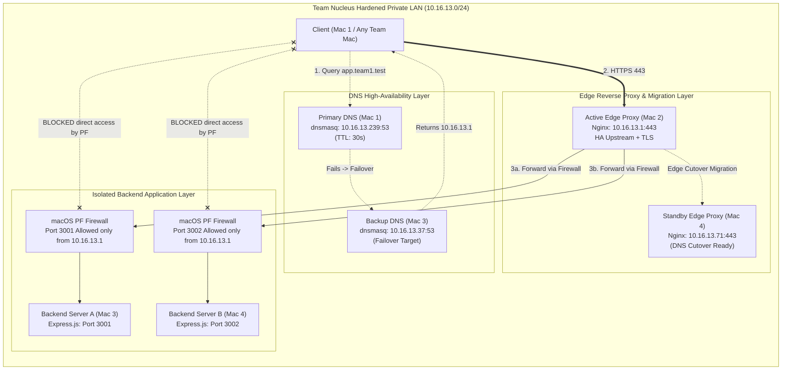
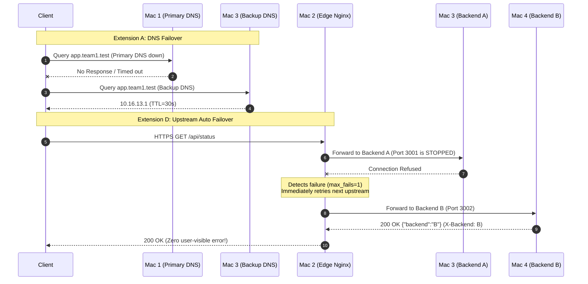

# Architecture Document (Phase 2 Update)

## 1. Machine Roles & IP / Service Table

| Machine | Owner | Primary Role | IP Address | Services & Ports |
| :--- | :--- | :--- | :--- | :--- |
| **Mac 1** | Friend (Akhil) | Primary DNS Server & Client | `10.16.13.239` | `dnsmasq` (UDP/TCP 53) |
| **Mac 2** | Akshith | Active Edge Proxy & Load Balancer | `10.16.13.1` | `nginx` (TCP 443, 8443, 80) |
| **Mac 3** | Mohit | Backend A + Backup DNS Server | `10.16.13.37` | Express (3001), `dnsmasq` (53), `pf` Firewall |
| **Mac 4** | Jayadeep | Backend B + Standby Edge Proxy | `10.16.13.71` | Express (3002), Standby `nginx` (443), `pf` Firewall |

---

## 2. Updated Phase 2 Network Topology Diagram

---

## 3. High-Availability & Resilience Sequence Flow

